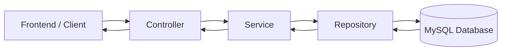

# Hotel Management System Backend

This project is a Spring Boot backend for a hotel management application. It exposes REST APIs for authentication, users, roles, rooms, and other hotel-related resources, and it stores data in MySQL through Spring Data JPA.

## 1. Project goal

The backend is responsible for:

- registering users and authenticating them
- protecting API routes with JWT-based security
- managing hotel data such as users, roles, rooms, and room types
- serving JSON responses to the frontend application

## 2. Technology stack

- Java 21
- Spring Boot 4.1.1
- Spring Web MVC
- Spring Data JPA
- Spring Security
- MySQL
- JWT using jjwt
- Maven

## 3. Main project structure

```text
backend/
├── src/
│   ├── main/
│   │   ├── java/com/sakhak/hotel/
│   │   │   ├── auth/
│   │   │   ├── config/
│   │   │   ├── security/
│   │   │   ├── user/
│   │   │   ├── role/
│   │   │   ├── room/
│   │   │   ├── roomtype/
│   │   │   ├── booking/
│   │   │   ├── customer/
│   │   │   ├── employee/
│   │   │   ├── payment/
│   │   │   ├── hotelservice/
│   │   │   └── HotelApplication.java
│   │   └── resources/
│   │       └── application.properties
│   └── test/java/com/sakhak/hotel/
├── pom.xml
├── mvnw
├── HELP.md
└── README.md
```

## 4. Typical request flow

The backend follows a standard Spring Boot layered architecture:

1. Browser or frontend sends an HTTP request to an API endpoint.
2. The controller receives the request.
3. The controller calls the matching service class.
4. The service validates business rules and calls repositories.
5. The repository interacts with MySQL using JPA.
6. The result is returned to the controller as JSON.
7. Spring security may validate JWT tokens before the request reaches the controller.

### Flow diagram



### Example flow: get all rooms

```text
GET /api/rooms
    -> RoomController
    -> RoomService
    -> RoomRepository
    -> MySQL rooms table
    -> Room entities converted to JSON response
```

## 5. Core backend layers

### Controller layer

Controllers handle HTTP requests and map endpoints to Java methods.

Examples:

- AuthController: login and registration endpoints
- UserController: user CRUD endpoints
- RoleController: role CRUD endpoints
- RoomController: room CRUD endpoints

These classes are under the package structure such as:

- com.sakhak.hotel.auth
- com.sakhak.hotel.users
- com.sakhak.hotel.roles
- com.sakhak.hotel.room

### Service layer

The service layer contains business logic. This is where validation happens before saving or reading data.

Examples:

- AuthService validates username, email, password, and user existence
- UserService handles create, update, delete, and read operations
- RoomService handles room logic and business rules

### Repository layer

Repositories are Spring Data JPA interfaces. They provide database access methods like:

- findByUsername
- findByEmail
- findById
- save
- delete
- existsByUsername

## 6. Authentication flow

This project uses JWT-based authentication.

### Register flow

```text
POST /api/auth/register
    -> AuthController
    -> AuthService
    -> validate request data
    -> check if username/email already exists
    -> encode password with BCrypt
    -> save user to database
    -> return success response
```

### Login flow

```text
POST /api/auth/login
    -> AuthController
    -> AuthService
    -> find user by username or email
    -> verify password
    -> check if account is enabled
    -> generate JWT token
    -> return token + user information
```

### JWT security flow

The security setup is in:

- SecurityConfig
- JwtAuthenticationFilter
- JwtService
- CustomUserDetailsService

The normal flow is:

1. User sends a request with Authorization: Bearer <token>
2. JwtAuthenticationFilter reads the header
3. JwtService validates the token signature and expiration
4. The username is extracted from the token
5. CustomUserDetailsService loads the user from the database
6. Spring Security creates the authenticated user context
7. The request continues to the controller if allowed

### Security configuration

The app allows public access to auth and basic management endpoints and keeps the API stateless with JWT.

Important parts:

- CSRF disabled for stateless API usage
- session policy set to STATELESS
- JWT filter added before the standard UsernamePasswordAuthenticationFilter
- password encryption handled with BCrypt

## 7. Auth endpoint summary

### Public endpoints

- POST /api/auth/register
- POST /api/auth/login

### Example request body for register

```json
{
  "username": "john",
  "email": "john@example.com",
  "password": "secret123"
}
```

### Example request body for login

```json
{
  "username": "john",
  "password": "secret123"
}
```

### Example response after login

```json
{
  "message": "Login successful",
  "token": "eyJhbGciOiJIUzI1NiJ9...",
  "user": {
    "id": 1,
    "username": "john",
    "email": "john@example.com",
    "roleId": 2,
    "role": "CUSTOMER"
  }
}
```

## 8. Database configuration

This project uses MySQL. The connection is configured in application.properties:

```properties
spring.datasource.url=jdbc:mysql://localhost:3306/hotel_management_v2
spring.datasource.username=root
spring.datasource.password=
```

The JWT secret is defined here as well:

```properties
jwt.secret=ThisIsMyHotelManagementSystemSecretKey123456789
```

Make sure your local MySQL server is running and the database exists before starting the app.

## 9. How to run the project

From the backend folder:

```bash
./mvnw clean install
./mvnw spring-boot:run
```

The app runs on port 8081 by default because of this setting:

```properties
server.port=8081
```

## 10. How to test

```bash
./mvnw test
```

## 11. Main architectural idea

This project follows a clean backend structure:

- Controller receives requests
- Service handles rules and logic
- Repository handles database access
- Security layer handles authentication and authorization
- Entities map to database tables

This makes the application easy to extend as new modules are added, such as bookings, payments, check-in, check-out, housekeeping, notifications, and more.

## 12. Best way to understand the project

If you are new to this codebase, read in this order:

1. application.properties
2. SecurityConfig
3. JwtAuthenticationFilter
4. JwtService
5. AuthController
6. AuthService
7. UserController / UserService
8. RoomController / RoomService
9. entity classes and repositories

That path will show you how the app is wired from request entry to database access.

## 13. Summary

This backend is a Spring Boot REST API for hotel operations with JWT authentication, JPA persistence, and layered service architecture. The main idea is simple:

- receive HTTP requests
- validate and process data in services
- store or read data from MySQL
- return structured JSON responses
- protect sensitive endpoints with JWT

If you understand this flow, you can trace almost any feature in the project quickly.
