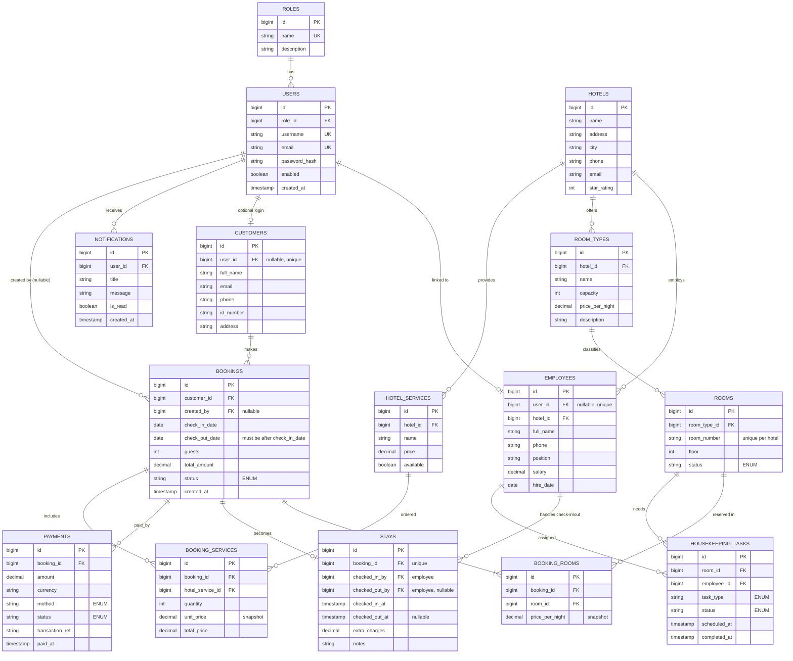

# Hotel Management System — ERD v3

Corrected version: multi-room bookings, no redundant hotel_id, merged stay record, price snapshots.

## What changed from v2

**Structure**

- Removed `hotel_id` from `ROOMS`; hotel comes via `ROOM_TYPES`.
- Added `BOOKING_ROOMS` so one booking can reserve several rooms.
- Merged `CHECK_INS` + `CHECK_OUTS` into `STAYS`, with employee audit fields.
- Added optional `USERS → CUSTOMERS` for online login.

**Data quality**

- Price snapshots: `BOOKING_ROOMS.price_per_night`, `BOOKING_SERVICES.unit_price`.
- `password` → `password_hash`.
- `created_by` is nullable; added `created_at` on bookings.
- Payments gain `currency` and `transaction_ref`.

**Constraints to implement**

- Unique: `users.username`, `users.email`, `roles.name`.
- Unique room number per hotel (enforce via a hotel-scoped check or trigger).
- `check_out_date > check_in_date`.
- No overlapping active bookings for the same room.
- Status/method/task_type fields as ENUMs or lookup tables.